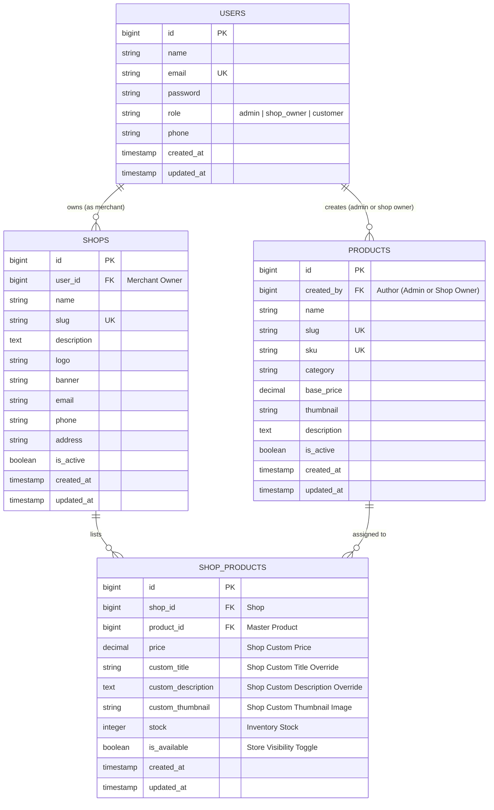

# Small E-commerce Management Platform

> **Candidate Assessment Submission**  
> **Role:** Full-Stack Laravel + React Developer  
> **Candidate:** Md Naimul Hasan Naeem  
> **Email:** [naimulhasan312005@gmail.com](mailto:naimulhasan312005@gmail.com)  
> **Submission To:** [career@csnbangladesh.com](mailto:career@csnbangladesh.com)  
> **Submission Deadline:** 11 November, 2026  
> **Live Local URL (Laravel Herd):** `http://small-ecommerce-management.test` or `http://localhost:8000`

---

## 📋 1. Project Overview & Architecture

This application is a full-featured, scalable multi-shop e-commerce management system developed with modern **Laravel 12**, **Inertia.js v3**, **React 19**, **Tailwind CSS v4**, and **MySQL**.

The platform is designed around a **Central Shared Product Catalog** paradigm:
- **Administrators** manage all shops, manage master products in the shared catalog, and register/manage shop owner accounts.
- **Shop Owners** can browse the shared master catalog, add products to their own shops, set or customize shop-specific prices, descriptions, and thumbnails, and contribute brand-new products to the shared catalog so other shop owners can discover and sell them too.
- **Customers** browse active shops and view shop-specific product offerings. **Products that are not assigned to any shop are strictly isolated and never visible to customers.**

---

## 🌟 2. Functional Requirements Implementation Matrix

| Requirement | Implementation Details | Status |
| :--- | :--- | :--- |
| **Admin Authentication** | Secure session authentication with role middleware protection (`EnsureRole:admin`), dashboard analytics, and quick one-click demo login. | ✅ Complete |
| **Admin Shop Management (CRUD)** | Full CRUD for shops: Name, unique slug, owner assignment (from shop owners), logo & banner upload, contact info, and active/inactive toggle. | ✅ Complete |
| **Admin Master Product Management (CRUD)** | Central catalog CRUD: Title, SKU, category, suggested base MSRP, thumbnail image upload, detailed specifications, and assigned shop counters. | ✅ Complete |
| **Manage Shop Owner Accounts (CRUD)** | Full CRUD for merchant accounts (`role = 'shop_owner'`), contact phone, password resets, and shop assignment relationship tracking. | ✅ Complete |
| **Browse Shared Product Catalog** | Shop owners can search and filter the shared catalog (authored by admin or other shop owners) and add any item to their shop with one click. | ✅ Complete |
| **Cross-Owner Catalog Availability** | Products authored by the admin or any shop owner are automatically visible in the shared catalog for all other shop owners. | ✅ Complete |
| **Shop Owners Create Own Products** | Shop owners can publish new products directly to the shared catalog and optionally list them immediately in their own store. | ✅ Complete |
| **Shop-Specific Customizations** | Shop owners can override and customize product prices, marketing descriptions, stock inventory, and upload shop-specific thumbnails. | ✅ Complete |
| **Customer Storefront Isolation** | Customers only see products assigned to active shops. Unassigned products (e.g. `PRD-UNASSIGNED-01`) are strictly excluded from customer views. | ✅ Complete |
| **Commercial Shopping Cart Drawer** | Client-side interactive shopping bag with slide-over drawer, quantity controls, free express shipping progress bar, and instant checkout simulation. | ✅ Complete |
| **Instant Evaluation Role Switcher** | Floating bottom-right 1-click persona switcher to seamlessly test Admin, TechNova Shop Owner, Aura Apparel Shop Owner, and Customer roles. | ✅ Complete |
| **Automated Testing & Code Quality** | **48 Automated PHPUnit Feature Tests (206 assertions)**, **PHPStan Level 7 (0 errors)**, **TypeScript `tsc` Check (0 errors)**, **Laravel Pint** PSR-12 code style. | ✅ Complete |
| **Database Export Included** | Standalone SQL dump included at project root (`ecommerce.sql`) and `database/ecommerce.sql` for instant manual import. | ✅ Complete |

---

## 🗄️ 3. Database Architecture & ERD Diagram



---

## 🚀 4. Quick Setup Instructions (Local Environment)

### Prerequisites
- **PHP:** `^8.2` or `^8.3` (with PDO, OpenSSL, Mbstring, Exif, GD extensions)
- **Composer:** `^2.x`
- **Node.js:** `^20.x` or `^22.x` & **NPM**
- **Database:** MySQL 8.0+ / MariaDB 10.5+

---

### Step-by-Step Installation

#### 1. Clone the repository
```bash
git clone <YOUR_PUBLIC_GITHUB_REPO_URL>
cd small-ecommerce-management
```

#### 2. Install PHP and Node dependencies
```bash
composer install
npm install
```

#### 3. Configure Environment
```bash
cp .env.example .env
php artisan key:generate
```

Configure your MySQL credentials in `.env`:
```env
DB_CONNECTION=mysql
DB_HOST=127.0.0.1
DB_PORT=3306
DB_DATABASE=small_ecommerce
DB_USERNAME=root
DB_PASSWORD=your_password
```

*(Create the database in MySQL if it doesn't already exist)*:
```sql
CREATE DATABASE small_ecommerce CHARACTER SET utf8mb4 COLLATE utf8mb4_unicode_ci;
```

#### 4. Create Symbolic Storage Link (for product thumbnails and shop logos)
```bash
php artisan storage:link
```

#### 5. Run Database Migrations & Seed Sample Data
```bash
php artisan migrate:fresh --seed
```
> *(Alternative: You can import the included standalone `ecommerce.sql` dump directly into your MySQL database).*

#### 6. Build Frontend Assets
```bash
npm run build
```
*(Or run `npm run dev` for Vite hot-module reloading during development).*

#### 7. Start the Local Server
```bash
php artisan serve
```
Open **`http://localhost:8000`** (or **`http://small-ecommerce-management.test`** if using Laravel Herd).

---

## 🔐 5. Default Test Accounts (Pre-Seeded)

All demo accounts use the standard password: `password123`

| Role | Name | Email | Password | Access Capabilities |
| :--- | :--- | :--- | :--- | :--- |
| **System Admin** | Platform Administrator | `admin@ecommerce.com` | `password123` | Full access to Admin Panel (`/admin/*`): Manage shops, master catalog products, and shop owner accounts. |
| **Shop Owner 1** | Alex Mercer | `tech@ecommerce.com` | `password123` | Owns **"TechNova Gadgets"**: Browse shared catalog, customize prices, details, thumbnails, and add new products. |
| **Shop Owner 2** | Sophia Bennett | `fashion@ecommerce.com` | `password123` | Owns **"Aura Apparel & Co."**: Re-lists shared products with custom boutique pricing and author of catalog items. |
| **Shop Owner 3** | Liam Vance | `living@ecommerce.com` | `password123` | Owns **"Nordic Living & Studio"**: Curates homeware and Scandinavian interior products. |
| **Customer** | John Customer | `customer@ecommerce.com` | `password123` | Public shopper: Can browse shops and shop-specific listings. |

> **Pro Tip for Reviewers:** The login page features **One-Click Quick Demo Buttons** that automatically populate credentials for instant testing!

---

## 🔬 6. How the System Solves the Core Requirements

### A. Shared Catalog Cross-Contribution & Listing
1. An **Admin** or a **Shop Owner** creates a product.
2. The product is saved in the master `products` table with its author recorded in `created_by`.
3. The product is immediately available in the **Shared Catalog** for every other shop owner to browse.
4. Any shop owner can click **"Add to Shop"** to assign that product to their shop with their own customized price, stock, and details.
5. In our seed data:
   - The product *"Pro Wireless Noise-Cancelling Headphones"* (`PRD-TECH-01`) was authored by the **Admin** with MSRP `$199.99`.
   - **TechNova Gadgets** listed it at a discounted shop price of **`$189.99`** with a custom description and custom black studio thumbnail.
   - **Aura Apparel & Co.** listed the exact same product from the shared catalog at **`$219.00`** with luxury gift packaging details and their own custom thumbnail.

### B. Strict Customer View Isolation
- Requirement: *"Customers should only see products assigned to a shop. Products that are not assigned to any shop must not be visible to customers."*
- Our queries strictly join or filter through the `ShopProduct` relationship of active shops.
- In our seed data, we intentionally created two master catalog products that have **never been assigned to any shop**:
  1. `PRD-UNASSIGNED-01`: *DJI Inspire 3 Pro Autonomous 8K Cinema Drone* ($1299.00)
  2. `PRD-UNASSIGNED-02`: *Italian Double-Faced Pure Cashmere Overcoat* ($590.00)
- You can verify in the Admin Panel (`/admin/products`) that these products exist in the catalog with status *"Unassigned (Hidden)"*.
- In the public customer views (`/` and `/shops/{slug}`), **neither of these unassigned products will ever appear**. Direct attempts to load them via `/shops/{slug}/products/{unassigned_id}` return a clean `404 Not Found`.

---

## 🧪 7. Automated Testing & Code Quality Verification

### Run Automated Tests
```bash
php artisan test
```
**Results:** `48 tests passed (206 assertions)` covering all CRUD operations, role authorization, shared catalog cross-listing, shop-specific price modifications, and customer view isolation.

### Run Static Analysis (PHPStan)
```bash
vendor/bin/phpstan analyse --memory-limit=1G
```
**Results:** `[OK] No errors (Level 7)`

### Run TypeScript & React Type Check
```bash
npm run types:check
```
**Results:** `[OK] 0 TypeScript compilation errors`

### Run Code Style Linting (Laravel Pint)
```bash
vendor/bin/pint --test
```
**Results:** `[OK] 100% PSR-12 code style compliant`

---

## 📂 8. Key Directory Structure

```
small-ecommerce-management/
├── app/
│   ├── Http/
│   │   ├── Controllers/
│   │   │   ├── Admin/
│   │   │   │   ├── AdminDashboardController.php
│   │   │   │   ├── ShopController.php           # Admin Shop CRUD
│   │   │   │   ├── ProductController.php        # Admin Master Catalog CRUD
│   │   │   │   └── ShopOwnerController.php      # Admin Shop Owner Account CRUD
│   │   │   ├── ShopOwner/
│   │   │   │   ├── ShopOwnerDashboardController.php
│   │   │   │   ├── ShopProductController.php    # Shop listings: prices, details, thumbnails
│   │   │   │   ├── SharedCatalogController.php  # Browse & add from shared catalog
│   │   │   │   └── CreateCatalogProductController.php # Contribute product to catalog
│   │   │   └── Customer/
│   │   │       └── CustomerController.php       # Public storefront & shop views
│   │   └── Middleware/
│   │       └── EnsureRole.php                   # Role-based authorization middleware
│   └── Models/
│       ├── User.php
│       ├── Shop.php
│       ├── Product.php                          # Master shared catalog model
│       └── ShopProduct.php                      # Shop-specific assignment & overrides
├── database/
│   ├── migrations/                              # Clean dedicated table migrations
│   ├── seeders/DatabaseSeeder.php               # Realistic sample data & isolation verification
│   └── ecommerce.sql                            # Standalone SQL database dump
├── resources/js/
│   ├── layouts/
│   │   ├── app-layout.tsx                       # Authenticated layout with role sidebar
│   │   └── customer-layout.tsx                  # Public storefront navbar & demo helper
│   ├── pages/
│   │   ├── Admin/                               # Admin Panel React views
│   │   ├── ShopOwner/                           # Shop Owner Panel React views
│   │   ├── Customer/                            # Customer Storefront React views
│   │   └── auth/login.tsx                       # Auth login with one-click demo pills
│   └── types/                                   # TypeScript interfaces
├── tests/Feature/
│   └── EcommerceManagementTest.php              # Comprehensive candidate requirement test suite
├── ecommerce.sql                                # Root standalone database dump
└── README.md
```

---

## 📬 9. Candidate Submission Details

- **Candidate Name:** Md Naimul Hasan Naeem
- **Email:** [naimulhasan312005@gmail.com](mailto:naimulhasan312005@gmail.com)
- **Application Sent To:** [career@csnbangladesh.com](mailto:career@csnbangladesh.com)
- **Task Submission Date:** 08 November, 2026

